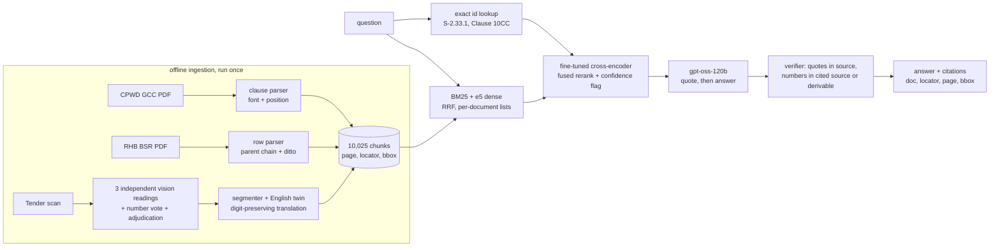

# Design notes

How a question becomes a cited answer, why each piece is the way it is, what I measured, and what I would
change for production. Numbers come from the files in `evals/results/` and `runs/`.

## 1. The documents and why they are hard

I picked three documents of different types that map onto one workflow a contractor actually runs: read a
tender notice, price the work, then live under the contract.

| Document | Type | What makes it hard |
|---|---|---|
| **CPWD General Conditions of Contract 2020** (112 pp.) | born-digital English contract | Clause titles sit in the left margin, not next to the clause text, so a naive text dump attaches them to the wrong clause. The bilingual appendix pages carry Hindi in a legacy Kruti Dev font that extracts as gibberish ("fufonk ,oa lafonk"). Printed page = PDF page - 2. Many answers depend on Schedule F, which is blank in this generic template. Confusable numbers: 5% and 10% each appear in three different clauses. |
| **RHB Basic Schedule of Rates 2024** (824 pp.) | table-heavy schedule of rates | The table is a hierarchy printed flat: a child row ("2.33.1 Pillar Cock 15 mm | Each | 787.00") means nothing without its parent ("Providing and fixing superior quality CP brass fittings"). "-do-" rows mean "ditto the row above". Item numbers restart in every chapter (1,097 numbers repeat), so "item 1.1.1" is ambiguous. Notes change rates ("add 50% for coloured chinaware over items 1.1 to 1.7"). The printed page "S-21" is PDF page 260. The source itself has defects: the same material at two rates, duplicate item numbers, a Rs 0.00 rate. |
| **Rajasthan PWD e-tender notice 68/2024-25** (6 pp.) | image-only Hindi scan | No text layer at all, handwritten fields (letter no. 1792, date 27-3-25), dense fee-slab tables, conditional amounts (EMD 0.5% inside the registration jurisdiction, 2% outside), mixed Hindi and English, and conflicts inside the notice itself (the intro invites "AA/A" class contractors while the table says "B - Class Civil"; condition 14 and 15 disagree on GST). |

Not chosen: the IS codes (scans with a broken OCR layer; the next document I would add), SP16 (charts and table
images), the two arbitration judgments (the natural next step for a delay-claims workflow: Clause 2/5 of the
contract plus how courts treat such claims), and PMGSY. The 46-page "PMGSY-III guidelines" scan is actually the
2011 guidelines, and the 2-page "selectable-text" summary has a corrupt text layer (wkhtmltopdf dropped the
conjuncts: "प्रधानमंत्री" extracts as "धानमंी"), which I used to test the text-layer quality check instead.

## 2. Architecture

Every chunk carries `doc`, `pdf_page`, the printed `page_label`, a `locator` (clause, item or tender condition)
and, where the PDF has coordinates, a bounding box. A chunk never spans a page, so a citation always lands on
one page. `cosorag show <chunk_id>` renders that page with the region highlighted.

## 3. Ingestion

**Contract.** PyMuPDF spans with font flags and positions. Bold "Clause N" lines start a clause; the margin title
is matched by vertical position (it is printed at the end of the page's text stream, so text order is useless).
Decoration (1 pt "1234567890" strips, running header, footer) and Kruti Dev lines are dropped. 68 clauses plus
Schedule F, Integrity Pact, Safety Code, labour regulations and forms; 344 chunks.

**Schedule of rates.** I tested generic table extractors first: PyMuPDF `find_tables` and pdfplumber recovered
54% and 56% of 63 hand-checked rows; the ruled-line strategies 0% (the table body has no lines). Positional
parsing does much better, so the parser segments rows by item-number anchors in the left
column (unit and rate cells sit 1-2 pt off the description baseline), then resolves the parent chain across
pages and expands "-do-" from the previous sibling. Each rated item becomes one chunk with a chapter-qualified
id (`S-2.33.1`), unit, rate and bbox; parents become "group" chunks listing their children; chapter notes become
their own chunks. A chunk puts the row first and its parent chain after ("S-2.33.1: Pillar Cock 15 mm | Each |
Rs. 787.00 / Part of: Providing and fixing superior quality CP brass fittings"): both encoders truncate at 256
tokens, and 22% of rows sit under a parent description long enough that a parent-first layout would cut off the
very words ("15 mm", the rate) that distinguish one row from its siblings. 8,159 rated rows plus 1,158 parent groups and 207 note chunks, 6 s for 824 pages. Measured: 63/63 hand-checked rows exactly right (item, unit,
rate, full multi-line description), but that is in-sample (two misses on those pages were fixed); the
out-of-sample evidence is that across the whole document an independently written parser (column
edges from the header box) agrees on the rate for 6,451 of 6,510 rows both extract (99.1%) and on the unit for
98.7% (`evals/bsr_crosscheck.py`). Disagreements cluster in three layouts: hire-charge tables with several rate
columns, rate ranges ("70.00 to 100.00") in horticulture, and a shifted unit column on some electrical pages.
About 3% of rows hold unnumbered variants ("(i) low porosity ... (ii) high porosity") and keep both rates in one
record.

**Tender scan.** I ran an OCR bake-off on 6 hand-transcribed regions (61 lines, 86 numbers):

| Engine | CER | Numbers exact | Notes |
|---|---|---|---|
| Claude Sonnet 4.6 (vision) | 0.6% | 86/86 | |
| Llama 4 Maverick (open-weight) | 2.0% | 81/86 | |
| Gemma 3 27B (open-weight) | 4.3% | 86/86 | stops early on dense pages |
| Tesseract 5 hin+eng (local) | 12.8% | 51/86 | best classical engine; "286.47" read as "6286.47" |
| RapidOCR PP-OCRv5 Devanagari (local) | 22.8% | 78/86 | drops whole lines |
| Pixtral Large | 20.1% | 71/86 | |

Even the best reader made two digit errors on this notice: "06.00" read as "08.00" (the bid deadline) and the
fee slab "151 lakh" read as "161 lakh". On a tender those are the errors that matter, so the notice is read by
three independent vision models, numbers are aligned by their neighbouring words, and every disagreement is
put to a stronger model as a targeted question with the page image ("near '...सांय __ बजे', is it 06.00 or
08.00?"). Both real errors were corrected, six false alarms were confirmed as the primary reading, and every
correction is stored on the chunk (`meta.ocr_corrections`). Field-level check against 94 hand-read fields:
primary 94/94, Llama 92/94, Gemma 70/94. The amounts also reconcile arithmetically (2% and 0.5% of Rs 286.47
lakh are exactly the printed EMDs 5,72,940 and 1,43,235).

Each tender segment gets an English twin (gpt-oss-120b) so English questions find Hindi text; a translation must
contain exactly the Hindi original's numbers or it is retried. Citations point at the Hindi page.

**Text-layer quality.** "Has a text layer" is not "has usable text": the PMGSY summary's layer drops conjuncts,
the IS-code layers lost their spaces, and the contract's appendix is in a legacy font. `src/cosorag/textlayer.py`
routes each page with three cheap signals (share of Devanagari words that start with a vowel sign, private-use
and control characters, glued letter-only tokens, plus a Kruti Dev word list). Over the whole corpus
(`scripts/check_text_layers.py`) it sends both PMGSY summary pages, 19 IS 456 pages and the 17 Kruti Dev pages of
the contract to OCR, and none of the 183 pages of the two born-digital judgments.

## 4. Retrieval

* **Exact id path first.** "item 2.33.1" and "2.33.6" differ by one digit, "Clause 10C" and "10CC" by one
  letter; embeddings blur exactly that. Ids in the query are looked up; a missing id is reported as missing
  ("Item S-2.33.40 does not exist"), and an id that exists in several chapters is reported as ambiguous.
* **BM25 + dense, fused with RRF.** BM25 (bm25s) uses a tokenizer that keeps `2.33.1`, `10cc` and
  `pwd2425wsob17397` whole, folds Devanagari digits and Indian digit grouping (5,72,940 = 572940), and
  normalises nukta and chandrabindu. Dense is multilingual-e5-small (118M, CPU). Brute-force cosine over 10k
  vectors takes milliseconds, so no ANN index.
* **Per-document lists.** The first error analysis showed the 32-chunk tender being drowned by 9,649 schedule-of-rates chunks,
  and tender questions answered from the CPWD contract. When a query names a document's vocabulary (tender,
  bid, EMD, निविदा / rate, sqm / clause, Engineer-in-Charge) that document's own top-10 joins the fusion. For
  reranking, the candidate pool is the fused top-20 plus every document's own top-3, so the cross-encoder, not
  the corpus size, gets a say between a clause, a rate row and a tender condition (a question like "within how
  many days must the agreement be signed?" carries no tender vocabulary at all).
* **Reranking is fused, not a re-sort.** The cross-encoder's order is combined with the hybrid order by RRF
  (same k=60), and the top 8 go to the generator. Re-sorting by the cross-encoder alone lost rows on long
  questions (section 6).
* **Neighbour expansion.** A clause can span pages; the next and previous chunk of a top clause are added.

## 5. Grounded generation

gpt-oss-120b (open-weight, Apache 2.0) on Bedrock in ap-south-1 (Mumbai). The model returns JSON: verbatim quotes
first, then an answer with `[S#]` markers. Rules that came out of the error analysis: say whether a rate is a
basic material rate (chapter G) or a complete item rate; if the asked size or variant is not listed, say so and
label the closest item as different; questions about "this tender" are governed by the notice, not the CPWD
contract; 1 crore = 100 lakh before applying slabs.

A deterministic verifier then checks: each quote occurs in the source it is attributed to; each cited source
exists; every number in the answer occurs in a cited source, in the question, or is one arithmetic step from
them (a computed difference is checkable, an invented number is not). A failure triggers one retry with the
reason; a remaining failure is shown to the user as a warning, never silently.

## 6. Model adaptation: a fine-tuned cross-encoder as reranker and grounding gate

**Why this and not something else.** The failure that matters most in rates and contracts is not "no answer",
it is a confident answer with a real citation to the wrong row: asked for a Grading 2 WBM rate, the baseline
answered Rs 1117 from the wet-mix-macadam row (correct: Rs 1112); asked for a 2.2 kW dewatering pump, it cited an
electrical-chapter pump at Rs 46,149 (correct: Rs 88,983). The number verifier cannot catch this, because the
wrong number really is in the cited chunk. A bi-encoder scores query and passage separately, so "20 mm" and
"15 mm" rows look almost identical to it. A cross-encoder reads them together and can learn that the attribute
mismatch is the whole point.

**Data.** gpt-oss-120b (Apache 2.0, so the training data has clean provenance) wrote, for 1,876 chunks, queries
the chunk answers (specific, paraphrase, Hindi or Hinglish for English text and English for Hindi text) and
near-miss queries it does not answer (one attribute changed: 30 mm to 25 mm, Sqm to cubic metre, 4-pole to
3-pole). Hard negatives were mined from the base hybrid retriever. Sibling rows (same parent, different size)
are deliberately kept as hard negatives, since telling 15 mm from 20 mm is the point; only chunks that may
legitimately answer the same query are excluded (the row's own parent "group" chunks, which list the row, and the
other chunks of the same clause or tender condition). Vague queries ("one of these pumps") were dropped.
Leakage guard: queries and negatives come only from TRAIN page blocks (fixed in `src/cosorag/splits.py` before
any data was generated), so DEV and TEST passages are never seen in training, as positives or as negatives. A
first training run had drawn negatives from the whole corpus; an independent code review caught it and the
model was retrained.

**Training.** `cross-encoder/mmarco-mMiniLMv2-L12-H384-v1` (118M, multilingual incl. Hindi), binary
cross-entropy with positive weighting, word embeddings frozen (keeps the multilingual vocabulary, cheaper steps),
one epoch on 9,519 pairs (2,173 positives, 6,519 mined hard negatives, 827 near-misses) in 91 minutes on a
4-core laptop CPU. The gate threshold (0.70, best balanced accuracy between real and near-miss queries) was
chosen on DEV pages only.

**Result in isolation.** On held-out synthetic queries from TEST page blocks (never trained on), against the
hybrid order and the same cross-encoder before fine-tuning:

| reranking (TEST pages: 400 questions, 200 near-misses) | Hit@1 | Hit@8 (in context) | MRR@10 |
|---|---|---|---|
| none (hybrid order) | 0.537 | 0.800 | 0.632 |
| off-the-shelf cross-encoder, re-sorted | 0.652 | 0.848 | 0.723 |
| fine-tuned, re-sorted | 0.708 | 0.882 | 0.779 |
| off-the-shelf, fused with the hybrid order | 0.590 | 0.850 | 0.684 |
| fine-tuned, fused with the hybrid order (submitted) | 0.640 | 0.873 | 0.726 |

| near-miss detection, AUROC (real question vs one attribute changed) | score on the source passage | top score over candidates |
|---|---|---|
| off-the-shelf | 0.45 | 0.41 |
| fine-tuned | 0.84 | 0.77 |

Fine-tuning helps consistently here (Hit@1 +5.6 points re-sorted, +5.0 fused) and turns a score that cannot tell
"15 mm" from "20 mm" (AUROC 0.45, worse than chance: the off-the-shelf model rewards the overlapping words) into
one that mostly can (0.84). Fusion gives back part of the gain on these short synthetic queries (Hit@1 0.708 to
0.640); that is the price of not trusting the cross-encoder alone on real, longer questions, explained next.

**Result end to end, and the mistake it exposed.** My first integration re-sorted the candidates by the
fine-tuned score and, when the top score was under the threshold, told the generator that no source clearly
answers. On the gold set it lost to having no reranker at all: 80.7% vs 83.9% judged correct, with over-refusal
rising from 2.4% to 10.7%. The per-question diff showed two causes:

1. *The threshold did not transfer.* It was chosen on short synthetic queries, where the score separates real
   questions from near-misses well (AUROC 0.86). On real gold questions the same score is weaker (AUROC 0.73;
   the off-the-shelf model is at chance, 0.53), and 48% of answerable questions fall under 0.70: long, multi-part
   practitioner questions ("extra material cost of upsizing a 50 m GI pipe run from 20 mm to 25 mm") score low
   against any single row, even the right one. The prompt note turned those into refusals.
2. *Re-sorting dropped rows.* Ranked by the cross-encoder alone, rows it misread on long questions fell out of the
   8 passages the generator sees (gold Hit@1 0.786 -> 0.750, Hit@8 0.976 -> 0.952), the same drop the
   off-the-shelf model caused.

The fix, chosen on the gold set only: fuse the cross-encoder's order with the hybrid order (RRF, the same untuned
k=60 as retrieval), and keep the gate score as a review flag shown with the answer instead of an instruction to
the generator. The first version had already been frozen and run once on the blind set; that run is reported
next to the fixed one.

| gold set (96) / blind set (30), judged correct | gold | blind | negatives handled, gold + blind |
|---|---|---|---|
| no reranker | 83.9% | 85.0% | 12/19 |
| off-the-shelf cross-encoder, fused | 86.5% | 85.0% | 11/19 |
| fine-tuned, re-sorted, gate note in the prompt (first version) | 80.7% | 86.7% | 14/19 |
| **fine-tuned, fused, gate as a flag (submitted)** | **84.9%** | **90.0%** | **16/19** |

**What I conclude.** Fusing a cross-encoder into the ranking helps; on real questions the fine-tuned and the
off-the-shelf one are tied as rankers once fused (gold Hit@1 0.833 vs 0.821, MRR 0.888 vs 0.893), although the
fine-tuned one is clearly better on the synthetic held-out queries. Fine-tuning did *not* raise overall accuracy
over a good off-the-shelf cross-encoder: across all 126 gold and blind questions both are at 86.1%, and every
paired difference is inside its interval. What it did change is the behaviour it was trained for: questions that
should be declined (near-misses, false premises, things the documents do not contain) are handled in 16 of 19
cases against 11 of 19 for the off-the-shelf model (12 of 19 with no reranker), better on both sets separately;
at n = 19 that is a consistent direction, not a proven effect. Its score is also a real, if uncalibrated,
answerability signal on real questions (AUROC 0.73 vs 0.53). The lesson I would take into production: an offline
metric on synthetic data is not a deployment threshold. A confidence score has to be calibrated on logged,
labelled real questions before it is allowed to change an answer; until then it routes answers to review.

**Alternatives I rejected.**
* Fine-tuning the bi-encoder (e5-small). The textbook choice and cheap, but exact ids and BM25 already resolve
  most lexical misses, so its gain mostly disappears inside the hybrid; and it cannot judge "does this passage
  answer?", which is the decision I need.
* LoRA on a small generator (Qwen3 0.6-1.7B) for cited answers and refusals. Distils a 120B model into a much
  weaker one; about 17-25 h on this CPU.
* Hindi OCR post-correction (ByT5). Published gains are 1.2-1.5 chrF++ and do not transfer across OCR engines;
  multi-reader voting fixed the errors that mattered.
* An answerability classifier on retrieval features. Cheaper, but the cross-encoder gives the same signal while
  also improving ranking.

## 7. Evaluation

**Gold set.** 96 questions written from the source pages before the system was run (32 contract, 36 rates,
28 tender), each with the answer, key facts, gold page and locator, and a question type (lookup, interpretation,
multi-hop, exact rate, child row, ditto, note modifier, cross-lingual, Hindi, Hinglish, table, conditional,
unanswerable, near-miss, false premise). They were drafted with an AI assistant directly from the pages and every
answer was re-checked against the page by a second pass. I ran two rounds of error analysis on this set (the
first fixed document routing, prompt rules and verifier arithmetic; the second, the reranker integration in
section 6), so it is a development set. The cleaner estimate is a **blind set of 30 questions** written by a
fresh pass on held-out pages after the code freeze, never read while building, and run once per configuration
(`evals/gold_blind/`).

**Metrics.** Correctness by an LLM judge (Claude Sonnet 4.6, a different family from the generator, sees the
gold answer, not the sources), plus a deterministic lower bound (every key fact found, format-tolerant for dates
and units). Citation hit: a cited chunk carries the gold clause or rate item (page level for the tender, which
has no finer locator). Negatives handled: on unanswerable, near-miss and false-premise questions, the judge
confirms the answer declined or rejected the premise. Over-refusal: the model declined an answerable question.
Share of answers with a number that is neither in a cited source nor derivable. Retrieval Hit@1/5 and MRR@10 at
locator level, per retrieval mode. 95% bootstrap intervals everywhere; paired bootstrap for before/after.

**Results of the submitted system** (all configurations and slices: [evals/RESULTS.md](evals/RESULTS.md)):

| | gold, 96 (development) | blind, 30 |
|---|---|---|
| judged correct | 84.9% [79, 91] | 90.0% [80, 98] |
| key facts all found (deterministic lower bound) | 75.0% | 66.7% |
| citation hit | 92.9% | 95.2% |
| negatives handled | 8/10 | 8/9 |
| over-refusal | 4.8% | 4.8% |
| answers with a number not in a cited source | 8.3% | 9.5% |

By document on gold: contract 85.9%, rates 84.7%, tender 83.9%. Latency on a free 4-core laptop CPU with warm
models: retrieval 0.03 s, cross-encoder 2.0 s for about 23 candidates, generation about 2 s (the logged p50 of
7.5 s in the runs was measured with other evaluation jobs sharing the CPU). Loading the models takes about 25 s
once per process.

Retrieval on the 84 answerable gold questions (locator level: the right clause, rate row or tender condition):

| mode | Hit@1 | Hit@8 (what the generator sees) | MRR@10 |
|---|---|---|---|
| BM25 (id-preserving tokenizer) | 0.738 | 0.905 | 0.798 |
| dense (multilingual-e5-small) | 0.667 | 0.881 | 0.748 |
| hybrid: RRF + exact ids + per-document lists | 0.786 | 0.976 | 0.855 |
| + off-the-shelf cross-encoder, fused | 0.821 | 0.976 | 0.893 |
| + fine-tuned cross-encoder, fused (submitted) | 0.833 | 0.976 | 0.888 |

**What still fails** (22 of 96 gold answers below full marks, 7 of them wrong):
* *Wrong row with a real citation*, twice, both traced to the rate parser: a 2.2 kW pump row whose parent
  description is printed as a numbered row of its own (so the row's chunk never says "submersible dewatering"),
  and a WBM grading row. A lettered variant ("H-2.1.4(b) with power machines") sits in one record with its
  sibling and the model read its rate as blank.
* *Notes retrieved but not applied*: "+5% for grade AA pipes", "proportionate for a tank 0.5 m longer". The note
  is in the context; the model declines to do the arithmetic.
* *A false premise accepted*: "why is compensation for delay capped at 5%?" is answered as if 5% were right (it is
  10%; 5% appears in three other clauses).
* *Cross-document leakage*: "the defect liability period for this work" (a tender question) is answered with the
  contract's 12 months, though the notice states none.
* *Partial answers*: a second condition omitted, an office named wrongly in a long condition.

### Answer writers compared, and the Bedrock-only live demo

With retrieval, the fine-tuned reranker and the verifier fixed, I swapped only the model that writes the answer
(`evals/generators.py`, gold set):

| writer | gold, judged correct | blind (run once) |
|---|---|---|
| Claude Opus 5.5 | 92.7% | |
| Claude Sonnet 5.5 | 91.7% | 96.7% |
| Claude Haiku 5.5 | 89.1% | |
| DeepSeek V3 | 88.0% | |
| Qwen3 235B | 87.5% | |
| gpt-oss-120b (first submission) | 84.9% | 90.0% |
| gpt-oss-20b | 83.9% | |

Most remaining Sonnet misses are the retrieval and parsing failures listed above (a rate row that never reaches the
context, a lettered variant whose rate sits in its sibling's record), so a stronger writer does not fix them.

The live demo runs Claude Sonnet 5.5 and replaces the two local models with Bedrock-hosted ones (Cohere Embed
Multilingual v3 for query vectors, Cohere Rerank 3.5), because the fine-tuned reranker needs PyTorch and about
2 GB of memory, more than the free host gives. That configuration scores 92.7% on gold and 96.7% on blind, with
every citation on target in the blind set. It has no review flag: no threshold has been calibrated for the hosted
reranker. Every stage's metrics for all configurations: [evals/METRICS.md](evals/METRICS.md).

The hosted reranker also gives the fine-tuned one an honest yardstick (84 answerable gold questions, right passage
first): on the e5 search, Cohere Rerank 3.5 reaches 0.881 against 0.833 for the fine-tuned 118M model; on the Cohere
search the fine-tuned model is ahead on that measure (0.869 against 0.857) and behind on MRR (0.908 against 0.915) and
nDCG@10 (0.846 against 0.871). A model trained in 91 minutes on a laptop CPU stays close to a much larger commercial
reranker. The web view (How it works, Fine-tuning next) lists what a GPU round would change.

### Input guardrail: routing before retrieval

The first live demo sent every message through retrieval, so "hi" came back with citations to a public address system's
hire charges: the writer had been handed eight unrelated rate rows and did its best with them. The chat now routes each
message before any search (`src/cosorag/guard.py`):

* **Four routes.** Document question (searched), greeting or small talk, a question about the assistant, and off-topic,
  which also covers attempts to change or reveal the instructions. Only the first reaches retrieval.
* **Fixed replies.** The router only picks the route; the replies for the other three are text written in the code,
  in English and Hindi. No model writes anything outside the cited-evidence path, so the bot cannot be talked into
  general knowledge or a made-up rate.
* **Asymmetric errors.** Routing a real question away hides an answer; searching a greeting wastes a second. The
  prompt says "when in doubt, docs", and an unparseable router reply is treated as a document question.
* **Cost and speed.** Plain greetings match a list without a model call. Everything else goes to Claude Haiku 5.5
  (median 1.05 s); on a first question it runs alongside the search, so it adds no wait; for a follow-up the same call
  also rewrites the question, replacing the separate rewrite call.
* **Measured.** `evals/router_eval.py`: 56 of 56 labelled messages routed correctly (greetings, Hindi, prompt
  injections, and tricky document questions such as "EMD?", "pillar cock rate", a greeting followed by a question, a
  false premise); 96 of 96 gold and 30 of 30 blind questions routed to the documents (blind reported as a count only);
  4 of 4 follow-up rewrites kept the subject. The labelled set is mine and small, and I changed the prompt once after
  the first run sent "how are you?" to the documents, so treat it as a development result.

## 8. Production and scale

* **Ingestion as a pipeline, not a script.** Content-hash every page; re-run only changed pages; per-page routing
  (native text, re-OCR, multi-reader for scans with numbers); store provenance and every OCR correction.
* **Storage.** At 10k chunks a numpy matrix is right. At 100k-10M: Postgres + pgvector (HNSW) with BM25 in the
  same database or OpenSearch, filtered by project, document type, version and access rights. Item and clause ids
  go into relational tables, not only into vectors.
* **Versions and amendments.** BSRs are revised yearly and contracts carry corrigenda and Schedule F values per
  contract; every chunk needs `effective_from` and a supersedes link, and answers must say which version they used.
* **Latency and cost.** Warm query on a laptop CPU: retrieval 0.03 s, reranking 2.0 s (a GPU or int8 ONNX brings
  it to tens of milliseconds), generation about 2 s. gpt-oss-120b costs about $0.15/$0.62 per million tokens, i.e. under Rs 0.1 per
  question. Mumbai hosting keeps tender data in India.
* **Quality gates.** The gold and blind sets become a CI gate (no deploy if correctness, citation hit or refusal
  recall drops); every query is traced (retrieved ids, scores, gate score, verifier result); low gate scores and
  verifier warnings go to a human review queue; user feedback becomes new eval items.
* **Security.** Documents are untrusted input: a malicious PDF can contain instructions. The generator only quotes
  and summarises sources, cannot call tools, and every claim is checked against source text.

## 9. Known limitations

What breaks today, roughly in the order I would fix it:

1. **Note scopes are not linked to items.** A note such as "add 15% if concrete is mixed without a mechanical
   mixer" or "add 5% for grade AA pipes" is its own chunk; the answer is only right if retrieval brings the note
   along with the rate. Fix: parse a note's scope ("items 1.1 to 1.7") and attach it to those items' records.
2. **Schedule of rates edge layouts.** About 3% of rows hold unnumbered variants and keep several rates in one
   record; horticulture rate ranges ("70.00 to 100.00"), multi-column hire-charge tables and a shifted unit column
   on some electrical pages are the places where the two parsers disagree. Defects in the source itself (the
   same material at two rates, reused item numbers, a Rs 0.00 rate) are reproduced, not resolved.
3. **No boxes on the scan.** The vision-model transcription has no coordinates, so tender citations point to the
   page and condition, not a highlighted box. Fix: align the text to a layout OCR pass that has boxes.
4. **Schedule F is blank.** The contract template leaves contract-specific values (who decides compensation,
   the deviation limit, the escalation threshold) empty; the system says so, but a real deployment must ingest
   each contract's own Schedule F.
5. **Evaluation scale.** 96 development questions and 30 blind ones give intervals of about plus or minus 8 and 15
   points. The gold sets were drafted with an AI assistant from the pages and checked against them, not written
   by a contracts or estimating professional, and correctness is graded by an LLM judge.
6. **Routing is keyword-based.** Three documents make keyword cues enough; with hundreds of documents this needs
   metadata filters and a learned router.
7. **CPU latency.** The cross-encoder adds about 2 s per question on a laptop CPU (int8 ONNX or a GPU brings it
   to tens of milliseconds).
8. **One closed model in ingestion.** The primary tender reading uses Claude Sonnet 4.6 (best measured CER); the
   open-weight readers were close on digits (Llama 4 Maverick 92/94 fields) and are used for the cross-check, so
   a fully open pipeline is a configuration change with a measured cost.
9. **The adaptation's gain is narrow and the gate is uncalibrated.** The fine-tuned reranker ties the same model
   off the shelf on overall accuracy and helps on declining near-misses (section 6). Its synthetic training
   queries are shorter and simpler than real ones, so its score runs low on long, multi-part questions; the
   threshold flags about half of real answerable questions for review. It is a review signal, not a decision.

## 10. With more time

1. **Delay-claims workflow.** Add the two arbitration judgments with paragraph-level citations (speaker-tagged,
   since half of a judgment is quoted precedent) so a question can run from Clause 2 / Clause 5 of the contract to
   how a court treated a similar claim. This is the workflow closest to COSO's delay-analysis and claims modules.
2. **Note scopes and versions.** Attach schedule-of-rates notes to the items they modify, and carry
   `effective_from` / supersedes links for revised schedules, corrigenda and each contract's Schedule F.
3. **A professional test set.** 50 questions written by a quantity surveyor and a contracts manager, used to
   calibrate the judge (agreement, kappa) and to replace the assistant-drafted gold set as the main benchmark.
4. **Calibrate the gate on real questions.** Today it is a review flag. Log real questions with their gate
   scores, label a few hundred, recalibrate the threshold (or train on real query shapes: long, multi-part,
   with arithmetic), and only then let it abstain; measure refusal recall against over-refusal on that set.
5. **Cheaper and faster.** int8 ONNX for the cross-encoder (CPU latency from ~2 s to tens of ms), and a second
   adaptation experiment on the embedder to see whether the two gains add up.
