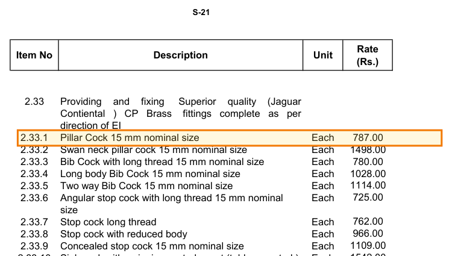

# Cited Q&A over Indian construction documents

Ask a question about a construction contract, an 824-page schedule of rates or a scanned Hindi tender notice,
and get an answer that points to the exact clause, item row or tender condition, with page numbers, or a clear
"the documents do not say".

```
$ uv run cosorag ask "What is the last date and time for submitting bids online?"
┌───────────────────────────────────── Answer (verified) ─────────────────────────────────────┐
│ The last date and time for submitting bids online is 15 April 2025 at 06:00 PM. [S1][S2]    │
└────────────────────────────── bedrock:openai.gpt-oss-120b-1:0 ──────────────────────────────┘
  [S1] Rajasthan PWD e-Tender Notice 68/2024-25, p. 3, condition 3  (nit:p3:condition3:0)
       "Tender documents in electronic format can be submitted on the website
       http://eproc.rajasthan.gov.in from 01.04.2025 at 9.30 a.m. to 15.04.2025 at 06.00 p.m."
  [S2] Rajasthan PWD e-Tender Notice 68/2024-25, p. 6, letterhead  (nit:p6:letterhead:0)
       "Bids for Building Construction / Maintenance works are invited from interested bidders
       upto 15-04-2025 (06.00 PM)."
  grounding gate: top passage score 0.87 (threshold 0.70)
```

The notice is an image-only Hindi scan; the quotes are the English twins of the Hindi conditions, and the
citations point at the Hindi pages. "06.00" is the value the most accurate OCR model misread as "08.00": three
independent readings and a targeted adjudication caught it ([DESIGN.md section 3](DESIGN.md#3-ingestion)).

Citations resolve to a row or clause, not a whole document: `cosorag show bsr:S:2.33.1`, or a click on a
citation in the local web view, renders the cited page with the region boxed (printed page S-21 is PDF page 260):



**Documents** (from the COSO test corpus): CPWD General Conditions of Contract 2020 (born-digital contract),
RHB Basic Schedule of Rates 2024 (824 pages of rate tables), Rajasthan PWD e-tender notice 68/2024-25 (6-page
image-only Hindi scan). Why these three and what makes each hard: [DESIGN.md](DESIGN.md#1-the-documents-and-why-they-are-hard).

**Model adaptation:** a multilingual cross-encoder fine-tuned on this corpus (laptop CPU, 91 min) on synthetic
questions and near-misses (same item, wrong size). It reranks the candidates, fused with the hybrid order, and its
score flags answers for review when no passage looks like it answers.
[Why this component, and what it did and did not improve](DESIGN.md#6-model-adaptation-a-fine-tuned-cross-encoder-as-reranker-and-grounding-gate).

## Results

| submitted system | gold set, 96 questions (development) | blind set, 30 questions |
|---|---|---|
| judged correct (LLM judge, 95% interval) | 84.9% [79, 91] | 90.0% [80, 98] |
| a citation points to the right clause / rate row / tender condition | 92.9% | 95.2% |
| negatives handled (not in the documents, near-miss, false premise) | 8 of 10 | 8 of 9 |
| over-refusal (declined an answerable question) | 4.8% | 4.8% |

- **The adaptation, honestly:** fused into retrieval, the fine-tuned cross-encoder ties the same model off the
  shelf on accuracy (86.1% each over all 126 questions) and handles more of the questions that should be
  declined (16 of 19 vs 11 of 19). Its score separates real questions from near-misses far better (AUROC 0.84
  vs 0.45 on held-out synthetic near-misses, 0.73 vs 0.53 on real questions), but a threshold chosen on synthetic
  queries did not transfer to real ones: my first integration let it steer the generator and lost 3 points. What I changed and why: [DESIGN.md section 6](DESIGN.md#6-model-adaptation-a-fine-tuned-cross-encoder-as-reranker-and-grounding-gate).
- **Reading the documents:** the scanned tender's 94 hand-read numeric fields are all correct after three
  independent readings and a targeted adjudication (the best single reader made two bid-changing errors); the
  rate parser agrees with an independently written parser on 99.1% of 6,510 rates.

Full tables: [evals/RESULTS.md](evals/RESULTS.md). Method and caveats: [DESIGN.md section 7](DESIGN.md#7-evaluation).

**Live demo:** https://coso-rag-web.vercel.app (the access code is in the submission email; it keeps the paid
model behind a gate). The same web view as `cosorag serve`, as a Vercel function in Mumbai; the first question
after a quiet spell loads the models and takes about 20 s. How it is built: [deploy/vercel](deploy/vercel/README.md).

## Setup

Python 3.11 or 3.12 and [uv](https://docs.astral.sh/uv/). CPU only; about 1.5 GB of disk for the environment and models.

```bash
git clone https://github.com/Umarfarook1/coso-construction-rag coso-rag && cd coso-rag   # short path: Windows 260-char limit
uv sync                                           # installs CPU-only torch
uv run python scripts/download_model.py           # fine-tuned reranker (~220 MB); without it: hybrid retrieval only
```

The processed documents (chunks, OCR output, translations) and the search index are committed, so no OCR,
PDF parsing or embedding is needed to ask questions.

### Ask a question

Pick one way to reach a language model (copy `.env.example` to `.env`):

| Option | What to set | Notes |
|---|---|---|
| No model at all | nothing | `cosorag ask --no-llm "..."` returns the cited passages only |
| Any OpenAI-compatible endpoint | `COSORAG_LLM=openai:<model>`, `OPENAI_BASE_URL`, `OPENAI_API_KEY` | e.g. Ollama `openai:qwen2.5:7b-instruct` at `http://localhost:11434/v1`, Groq, vLLM, OpenRouter |
| AWS Bedrock (used for the results) | `AWS_BEARER_TOKEN_BEDROCK` (a Bedrock API key) | gpt-oss-120b (open-weight) in ap-south-1 Mumbai; the evaluation judge is Claude Sonnet 4.6 on Bedrock |

```bash
uv run cosorag ask "What is the rate of a 15 mm CP brass pillar cock?"
uv run cosorag ask "मानसून में भी काम पूरा करने की अवधि क्या है?"
uv run cosorag ask --sources "Who decides the compensation for delay under the contract?"
uv run cosorag show bsr:S:2.33.1          # renders the cited page with the row highlighted (needs the PDFs)
uv run cosorag serve                      # local web view at http://127.0.0.1:8000: click a citation to see the page
```

More questions with their real answers, including the ones that should fail: [EXAMPLES.md](EXAMPLES.md).

### Reproduce the evaluation

```bash
uv run python evals/harness.py report runs/final          # reprint the reported run, no keys needed
uv run python evals/harness.py retrieval --split all      # retrieval ablation, CPU only, no keys
uv run python adapt/eval_reranker.py --split test         # adaptation before/after on held-out pages, no keys (~45 min CPU)
uv run python evals/ocr_eval.py                           # OCR field accuracy on the Hindi scan
uv run python evals/harness.py e2e --name mine --split all  # full end-to-end run (needs a model + Bedrock for the judge)
uv run pytest -q
```

### Rebuild everything from the PDFs

```bash
uv run --with gdown python scripts/download_corpus.py     # the COSO corpus into data/raw/
uv run cosorag ingest                                     # parse contract + rates, segment the tender
uv run python scripts/ocr_nit.py                          # re-read the scan (Bedrock vision models)
uv run cosorag index                                      # embed chunks (about 10 min on a laptop CPU)
uv run python adapt/gen_queries.py                        # synthetic training queries (gpt-oss-120b)
uv sync --extra train
uv run python adapt/build_pairs.py && uv run python adapt/train_reranker.py   # ~90 min on a 4-core CPU
uv run python adapt/eval_reranker.py --split dev --write-gate
```

## Repository map

| Path | What |
|---|---|
| `src/cosorag/ingest/` | `gcc.py` clause parser, `bsr.py` rate-row parser, `nit.py` tender segmentation, `vote.py` OCR number voting |
| `src/cosorag/textlayer.py` | per-page check: trust the PDF text layer or re-OCR |
| `src/cosorag/retrieve.py`, `index.py` | exact id lookup, BM25 + dense, RRF, per-document lists |
| `src/cosorag/rerank.py` | cross-encoder scoring, fusion with the hybrid order, review-flag threshold |
| `src/cosorag/answer.py` | prompt, quote-then-answer, deterministic verifier |
| `src/cosorag/show.py`, `serve.py` | page render with the cited region highlighted, local web view |
| `scripts/` | corpus download, tender OCR, model download/packaging, `run_all_evals.sh` (the exact evaluation procedure) |
| `deploy/vercel/` | the web view as a Vercel function: staging, build-time model fetch, access code |
| `adapt/` | synthetic data, pair mining, training, before/after evaluation |
| `evals/` | gold set, blind set, harness, judge, OCR evaluation, results |
| `data/processed/` | chunks, OCR readings, translations (committed) |

## Known limitations

The short version (details and fixes in [DESIGN.md section 9](DESIGN.md#9-known-limitations)):

- **Rate notes are separate chunks.** "Add 50% for coloured chinaware over items 1.1 to 1.7" is only applied if
  retrieval brings the note along with the rate; note scopes are not yet linked to the items they modify.
- **About 3% of rate rows** (unnumbered variants, rate ranges, multi-column hire charges) are stored as one record
  with several rates, and defects in the schedule itself (same material at two rates, a Rs 0.00 rate) are reproduced.
- **Tender citations have no highlight box.** The scan was read by vision models, which return text without
  coordinates, so a tender citation points to the page and condition only.
- **Schedule F is blank in the contract template,** so "who decides" and "what percentage" questions often end in
  "the template leaves this to Schedule F". That is correct for this document, and useless for a real contract.
- **Small evaluation.** 96 development questions and 30 blind ones (intervals of about plus or minus 8 and 15
  points), drafted with an AI assistant from the pages, not by an estimator or contracts manager; an LLM judges correctness.
- **Keyword routing between documents** is fine for three documents and would not survive three hundred.
- **The review flag is uncalibrated.** Its threshold came from synthetic questions and flags about half of real,
  correctly answered questions; it needs calibration on logged real questions before it can be trusted to abstain.
- **Known wrong answers** on the gold set: two wrong rate rows from unusual table layouts, rate notes retrieved but
  not applied, one false premise accepted. Listed in [DESIGN.md section 7](DESIGN.md#7-evaluation).
